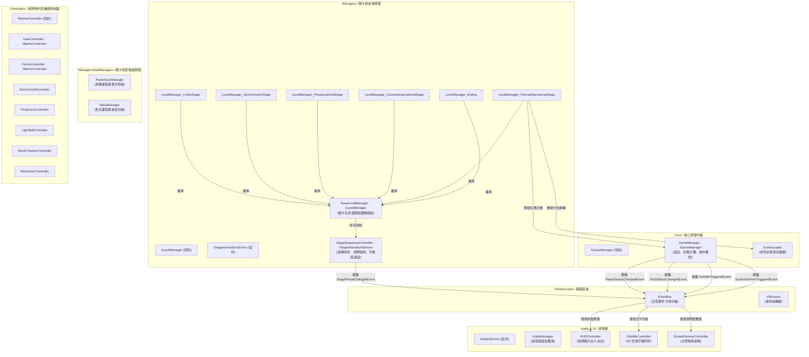

# 《覺醒協議》 (Awakening Protocol)

<div align="center">

[](https://unity.com/)
[](https://www.meta.com/quest/)
[](https://docs.unity3d.com/Packages/com.unity.xr.interaction.toolkit@3.0/manual/index.html)
[](https://unity.com/)
[](https://learn.microsoft.com/dotnet/csharp/)

</div>

## 專案簡介

《覺醒協議 (Awakening Protocol)》是一部基於瑞士心理學家皮亞傑 (Jean Piaget) 兒童認知發展理論開發的 VR 冒險解謎遊戲。玩家在虛擬認知重構設施中甦醒，依序通過象徵不同認知階段的環境試煉，重構自我意識與邏輯思維，並根據遊玩過程中的累積失敗次數導向雙結局分支。

本專案重點在於**模組解耦**、**關卡流程抽象化**與 **XR Interaction Toolkit (XRI 3.0)** 的工程實踐，消除過場時序與各關卡之間的重複代碼，確保流暢穩定的 VR 互動體驗。

---

## 實機展示影片

* 🎥 **實機展示影片**：[https://youtu.be/QG96sBGAUuI](https://youtu.be/QG96sBGAUuI)

---

## 核心玩法與關卡試煉

遊戲以皮亞傑認知發展四階段為設計骨幹，玩家必須在 VR 空間中以雙手實體互動通過一連串環境謎題：

* **Stage 0: 邊界序章 (Limbo Stage)**：
  - 玩家在極簡黑白抽象空間甦醒，跟隨前方幽浮巡航的導引光球前進，熟悉 VR 視角轉向、平移與瞬移操作，抵達首道閘門。
* **Stage 1: 感覺動作期 (Sensorimotor Stage)**：
  - 環形房間周遭懸浮著高低不同的音階光球。光球會依特定旋律發光並發出音階，玩家必須伸出雙手實體觸碰光球，按照正確順序彈奏複誦旋律，達成感覺與動作的協調反饋以開啟閘門。
* **Stage 2: 前運思期 (Preoperational Stage)**：
  - 空間幾何形狀與符號匹配。玩家需在場景中抓取不同形狀的 3D 積木（立方體、圓柱等），精確嵌入對應形狀的插槽檢驗基座。若不慎掉落，物件會自動平滑回彈至原位，全數配對完成後解開防護柵欄。
* **Stage 3: 具體運思期 (Concrete Operational Stage)**：
  - 能量算式守恆解謎。中央為一座斷開的高架通路，兩側基座擺放著標有數字與運算符號（+、-、×）的能量電池。玩家需抓取電池插入左右電路槽，使兩側電壓算式數值相等達成平衡，成功通電後中央升降大橋升起。
* **Stage 4: 形式運思期 (Formal Operational Stage)**：
  - 高階抽象假設與迷宮抉擇。迷宮內部會依據玩家當前累計的失敗次數動態切換格局（共 8 種迷宮走向），玩家必須在多重岔路與帶有符號的「生門 / 死門」之間進行邏輯推理。一旦選錯死門將被電網阻隔並重置回迷宮起點。
* **Stage 5: 雙結局分支 (Dual Branching Endings)**：
  - 由 `GameManager` 全程記錄總失敗次數。若失敗次數低於門檻，通過終點線後迎來「意識成功覺醒」的明亮結局；若失敗過多則觸發「重構失敗」的重置輪迴。

---

## 系統架構圖



---

## 軟體架構與技術實踐深度說明

本專案在技術實作上專注於「高內聚、低耦合」的架構分層，解決 VR 互動開銷、過場狀態衝突與關卡流程重複性問題：

### 1. XR Interaction Toolkit (XRI 3.0) 整合與互動狀態遮罩
* **用了什麼技術**：Unity 官方 XR Interaction Toolkit (XRI 3.0)，配置 `XR Origin`、雙手近遠端射線 (`Near-Far Interactor`)、直接抓取 (`XRDirectInteractor`) 與各類互動組件 (`XRGrabInteractable`, `XRSimpleInteractable`)。
* **為何而用**：提供標準化、低延遲的立體空間互動與位移控制，相容 OpenXR 跨平台標準，避免手寫射線與碰撞判定導致抖動。
* **怎麼設計**：在 `PlayerController` 統一管理移動（Continuous Move）、轉向（Snap Turn）、瞬移（Teleportation）與雙手射線互動器模組。
* **用什麼方法 (設計模式/演算法)**：
  - **事件驅動輸入遮罩 (Event-Driven Locomotion Masking)**：訂閱 `EventBus` 的 `PlayerStatusChangedEvent`。當過場動畫播放或黑幕淡出時，集中禁用 Locomotion 與射線組件，防止玩家在劇情時序中走動出界或誤觸機關。
  - **裝飾器防呆回彈 (Decorator Pattern)**：在 `XRGrabInteractable` 物件（電池、積木）附加通用工具 `ReturnToAnchor`。當玩家放手（`selectExited`）且物件未成功吸附至檢驗槽時，呼叫 DOTween 平滑回彈至原始錨點，解決 VR 抓取掉落穿模卡死的問題。
  - **互動訊號轉接解耦**：音階燈球掛載 `XRSimpleInteractable`，僅監聽接觸事件並轉發為自定義 C# `OnBallTouched` 事件，隔離關卡管理器對 XRI 底層 API 的依賴。

### 2. 關卡生命週期與模板方法模式 (Template Method Pattern)
* **用了什麼技術**：抽象基類 `BaseLevelManager` 與 6 個實體關卡控制器 (`LevelManager_*.cs`)，統一實作 `ILevelManager` 介面契約。
* **為何而用**：6 大關卡具備高度一致的流程（開場語音時序 ➔ 玩家解謎判定 ➔ 通關語音 ➔ 開啟終點閘門 ➔ 切換場景）。若各關卡單獨撰寫，會產生大量冗餘代碼與維護盲點。
* **怎麼設計**：將開場流程、語音觸發、過場中介協調與通關切換固化在 `BaseLevelManager` 抽象基類中，開放 `InitializeLevel()` 與各關特化檢查方法供子類覆寫。
* **用什麼方法**：
  - **模板方法模式 (Template Method Pattern)**：基類定義標準時序骨幹，子類專注自身特化邏輯（如：感覺動作期檢驗音階順序、前運思期檢驗積木插槽、形式運思期比對迷宮生門）。
  - **依賴反轉原則 (DIP)**：關卡管理器僅依賴 `IStageAnimationService` 與 `IBarrierController` 等抽象介面，不直接持有具體場景控制器實體。

### 3. 過場時序調度與中介者模式 (Mediator Pattern)
* **用了什麼技術**：通用過場控制器 `StageSequenceController`，實作 `IStageAnimationService` 介面契約。
* **為何而用**：關卡過場需要同步協調全景暗角淡出 (`ScreenDimmerController`)、語音播放 (`AudioManager`) 與 3D 空間字幕 (`SubtitleController`)，若由關卡管理器直接操縱各個視圖，會導致高度耦合。
* **怎麼設計**：`StageSequenceController` 擔任中介者角色，封裝「開場時序 (`TriggerOpeningProcess`)」與「結尾時序 (`TriggerEndingProcess`)」的協程流水線。
* **用什麼方法**：中介者模式 (Mediator Pattern)、Unity 協程 (Coroutines) 時序同步。

### 4. 模組解耦與泛型事件匯流排 (EventBus)
* **用了什麼技術**：純 C# 靜態泛型 `EventBus`，配合 `VREvents` 定義之領域事件結構體。
* **為何而用**：消滅場景內昂貴的 `FindObjectOfType` 與物件間的互相參照，提高模組獨立性。
* **怎麼設計**：內部以 `Dictionary<Type, Delegate>` 維護事件委派，監聽者在 `OnEnable` 與 `OnDisable` 進行生命週期訂閱與註銷。
* **用什麼方法**：發布-訂閱模式 (Publish-Subscribe Pattern)。

### 5. ScriptableObject 音訊與語音配置資產化 (SFXList)
* **用了什麼技術**：`Audio/SFXList.cs` 繼承 Unity `ScriptableObject`。
* **為何而用**：遊戲 6 大關卡具備大量語音引導、環境音與機關音效（音階聲、電網滋滋聲、閘門滑動聲）。若硬編碼在各場景或腳本中，會造成音訊資源分散難以維護。
* **怎麼設計**：定義專屬資料容器資產，集中管理鍵值名稱與 `AudioClip` 的對應陣列；`AudioManager` 在載入時注入該資產，提供 `GetClip(string key)` 供全局查詢。
* **用什麼方法**：資料驅動設計 (Data-Driven Design)、外部化資源字典快取。

### 6. 程式化補間動畫與平滑回彈 (DOTween & TransformAnimator)
* **用了什麼技術**：DOTween 補間動畫引擎與 `TransformAnimator.cs`。
* **為何而用**：場景中眾多懸浮光球、裝飾物件若全數掛載 Animator Controller，會產生大量不必要的狀態機開銷；而在 VR 中物件放手回彈需要平滑自然的物理曲線。
* **怎麼設計**：`TransformAnimator` 以數學正弦與旋轉矩陣在 `Update` 內驅動自體微幅旋轉、上下浮動與呼吸縮放；`ReturnToAnchor` 在放手時調用 `transform.DOMove` 與 `DORotate` 搭配 `Ease.OutBack` 彈性曲線回彈。
* **用什麼方法**：程式碼驅動補間 (Code-Driven Tweening)、緩動曲線演算法 (Easing Functions)。

---

## 核心介面契約規範 (Interfaces)

| 介面契約 (Interface) | 實作類別 (Implementation) | 職責說明 |
| :--- | :--- | :--- |
| `ILevelManager` | `BaseLevelManager` (派生 6 大關卡) | 抽象化關卡生命週期與通關判定 (Template Method) |
| `IStageAnimationService` | `StageSequenceController` | 控管關卡開場/結尾時序、視野暗角補間與字幕廣播 |
| `IBarrierController` | `GateController`, `FenceController` | 規範通行阻擋物（閘門、柵欄）之開關狀態與事件反饋 |
| `IGameManager` | `GameManager` | 維護遊戲全域狀態、失敗計數與雙語切換 |
| `IAudioService` | `AudioManager` | 集中調度關卡音效播放與 `SFXList` 語音資產快取 |

---

## 模組架構與檔案拓撲 (Architecture Topology)

```text
awakening-protocol/
├── Core/               # 遊戲全域狀態與非同步換關 (GameManager, SceneLoader)
├── Managers/           # 關卡流程抽象與時序仲裁 (BaseLevelManager, StageSequenceController)
│   └── SubManagers/    # 局部解謎演算法 (動態迷宮切換 MazeManager, 等式算式 PowerQuizManager)
├── Controllers/        # 場景互動機關 (終點閘門 Gate, 電網障礙, 能量電池, 提示燈球)
├── Player/             # VR 體感控制器 (XR Origin, 近遠距互動 PlayerController)
├── Infrastructure/     # 核心基礎設施 (泛型 EventBus, 放手平滑回彈 ReturnToAnchor, 補間動畫)
├── Audio/              # 音效服務與 ScriptableObject 語音配置 (SFXList)
├── UI/                 # VR 空間介面 (全景暗角過場, 3D 雙語字幕, HUD, 暫停選單)
└── Shaders/            # 自定義邊緣輪廓與剪影著色器 (PureEdgeLine, SilhouetteEffect)
```
